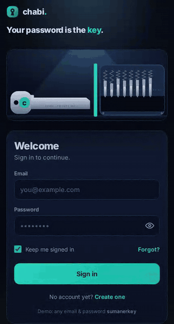

<div align="center">

# 🔑 Chabi

### A sign-in form that cuts a key.

Type your password and a tiny hammer strikes one notch into the key for every character.
Press **Sign in** and the key slides into the lock. Only the right password opens it.

<a href="https://sarowarsuman.github.io/Chabi/">
  
</a>

[](https://sarowarsuman.github.io/Chabi/)


<br>



</div>

---

> [!NOTE]
> **Just a fun project.** This is not a real login system. The password is checked in the browser and is visible in the source code, so never use it for anything real.

## ✨ Features

- 🔨 **Hammer-cut key**: every character of your password strikes a notch, with flying steel chips and sparks.
- 🔐 **Real lock mechanics**: the pins ride the notches as the key slides in, and only line up with the right password.
- 🚫 **Wrong password?** The key still goes in, but the pins turn red and the lock stays shut.
- 📱 **Phone friendly**: the animation stays pinned at the top while you type, with large touch targets.
- 🪶 **Tiny**: a single `index.html`, no libraries and no build step.

## 🎮 Try it

| Field    | Value            |
| -------- | ---------------- |
| Email    | any email        |
| Password | `sumanerkey`     |

1. Type an email. Its first letter is stamped on the key.
2. Type the password and watch the hammer cut the key.
3. Press **Sign in** and the key slides into the lock.
4. Try a wrong password too, then fix one letter and the notch is re-cut.

## ⚙️ How it works

1. Each character of the password is turned into a notch depth, and the hammer cuts it into the key.
2. On **Sign in**, the key slides into an 8-pin lock and the pins ride the notches.
3. If every pin lands on the shear line, the pins turn green and the key turns. Otherwise they turn red and the lock stays shut.

## 🧰 Built with

| Part      | Used                                     |
| --------- | ---------------------------------------- |
| Markup    | Plain HTML                               |
| Styling   | Plain CSS (dark navy and teal theme)     |
| Animation | SVG and vanilla JavaScript               |
| Font      | Inter from Google Fonts                  |

## 📁 Project structure

```text
Chabi/
├── index.html           # the whole app: HTML, CSS and JS
├── README.md
└── assets/
    ├── live-button.svg  # the 3D "Open live demo" button
    └── preview.gif      # demo recording
```

## 🚀 Run locally

Open `index.html` in any modern browser. No build step, no dependencies.

## 🌐 Deploy on GitHub Pages

1. Push `index.html` and the `assets` folder to your repo.
2. Go to **Settings → Pages**.
3. Under **Build and deployment**, choose **Deploy from a branch**, pick `main` and `/ (root)`, then **Save**.
4. After a minute it is live at `https://<your-username>.github.io/<repo-name>/`.

## 🙌 Credits

Inspired by a "Chabi" sign-in reel by Code Mode. The code, design and animation here are written from scratch.
